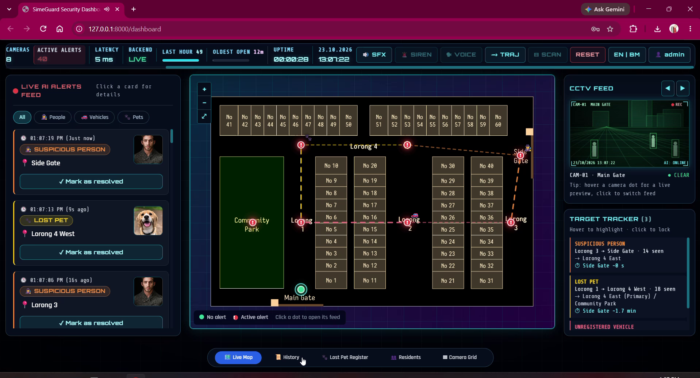
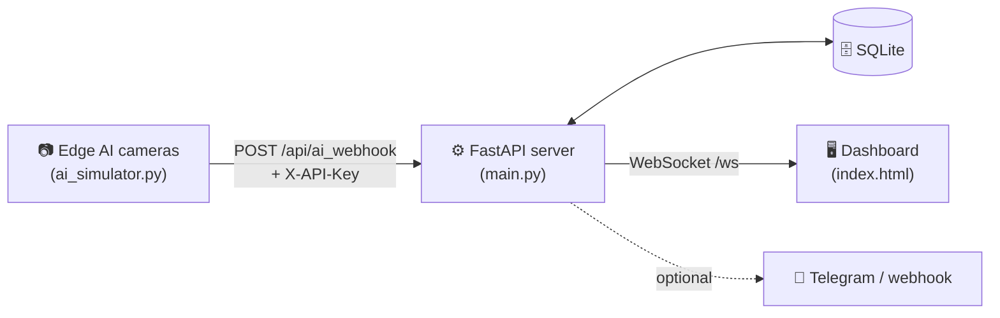

<div align="center">

# 🛡️ SimeGuard

### AI-powered Smart Community Security & Emergency Response Network

*Sime Darby Property Open Innovation Challenge submission*


**Team WCNF** ·  **Setup video:** _add link here_

[Quick Start](#-quick-start) · [Manual Setup](#-manual-setup) · [Demo Logins](#-demo-logins) · [Tests](#-running-the-tests) · [Troubleshooting](#-troubleshooting)

</div>

---

<div align="center">



</div>

## 📖 About

SimeGuard tackles real security problems in Malaysian townships. An edge AI camera network reports what it sees, the server tracks each target across cameras, and guards get a live dashboard with the predicted next camera and the fastest route to the exit gates. Residents get a self-service portal for reporting lost pets.

## ✨ Key Features

| Feature | What it does |
|---|---|
| 🎯 **Real-time AI tracking** | Receives camera detections by webhook and shows live threats on the community map. |
| 🧭 **A\* route planning** | Calculates the fastest route and ETA to the nearest gate for each tracked target. |
| 🔮 **Trajectory prediction** | Predicts the next camera a target will reach and recommends where to send a patrol. |
| 👥 **Role-based access** | Separate views for **Admins**, **Guards** and **Residents**. |
| 🐾 **Lost pet reports** | Residents report a pet; sightings are matched to it and the owner is identified. |
| 🔔 **Push notifications** | Optional Telegram and webhook alerts (English or Bahasa Malaysia). |
| 🔒 **Local and private** | Data stays in a local SQLite database; alerts stream over WebSockets. |

## 🏗️ How It Works



## 📁 Project Structure

```
Simeguard/
├── Simeguard_Backend/
│   ├── main.py            # FastAPI server (API, auth, WebSockets, A* routing)
│   ├── ai_simulator.py    # Simulated edge AI cameras (sends webhooks)
│   ├── index.html         # Dashboard front-end
│   ├── Community_map.png  # Township site plan used by the map
│   ├── test_main.py       # Automated tests
│   └── .env.example       # Configuration template
├── docs/                  # Dashboard screenshot
├── requirements.txt       # Runtime dependencies
├── requirements-dev.txt   # Test dependencies
├── start.bat              # Windows: one-click setup + start server
├── start_simulator.bat    # Windows: start the AI camera simulator
└── run_tests.bat          # Windows: run the test suite
```

## ✅ Prerequisites

- **Python 3.10 to 3.13 recommended** (3.8 and 3.9 also work). Python 3.14 is supported through a newer `pydantic` requirement but has had less testing, so if installation fails on a brand-new Python, install 3.12 or 3.13. On Windows, tick **"Add Python to PATH"** during install.
- **Internet connection.** It is needed to install packages on the first run, and the dashboard loads Tailwind CSS, Leaflet and Google Fonts from CDNs, so it looks broken offline.

## 🚀 Quick Start

**Windows, no terminal needed:**

1. Extract the project and **double-click `start.bat`**.
   It creates a `.venv`, installs the packages, starts the server and opens <http://127.0.0.1:8000/dashboard>.
2. **Double-click `start_simulator.bat`** to start the simulated cameras.
   Live threats, alerts and A\* trajectory lines now appear on the map.
3. Sign in with a [demo login](#-demo-logins).

💡 Keep both windows open. Close them (or press `Ctrl+C`) to stop.

> [!NOTE]
> **Windows may show "The publisher could not be verified."** This is normal for `.bat` files downloaded from the internet. Click **Run** (or **More info > Run anyway**). The scripts only create a virtual environment and start the local server.

**🎬 Setup video (Quick Start and Manual Setup):** _add link here_

## 🔧 Manual Setup

Use this on Mac/Linux, or if you prefer a terminal or VS Code. Open the **project root** (the folder containing `requirements.txt`) and start a terminal (**Terminal > New Terminal** in VS Code).

### 1. Create and activate a virtual environment

```bash
python -m venv .venv
```

| Shell | Activate with |
|---|---|
| Mac / Linux | `source .venv/bin/activate` |
| Windows Command Prompt | `.\.venv\Scripts\activate.bat` |
| Windows PowerShell | `.\.venv\Scripts\Activate.ps1` |

The prompt should now start with `(.venv)`.

> [!TIP]
> **PowerShell says "running scripts is disabled"?** Run this once in that window, then activate again:
> `Set-ExecutionPolicy -Scope Process -ExecutionPolicy RemoteSigned`

### 2. Install dependencies

```bash
python -m pip install -r requirements.txt
```

A yellow "new version of pip is available" warning is harmless.

### 3. Start the server

```bash
cd Simeguard_Backend
python -m uvicorn main:app --reload
```

Wait for `Uvicorn running on http://127.0.0.1:8000` and leave this terminal open.

### 4. Open the dashboard

Go to <http://127.0.0.1:8000/dashboard> and sign in, for example `admin` / `admin123`.

### 5. Start the camera simulator

Open a **second terminal**, make sure it shows `(.venv)` (activate it as in step 1 if not), then:

```bash
cd Simeguard_Backend
python ai_simulator.py
```

## 🔑 Demo Logins

| Role | Username | Password |
|---|---|---|
| 👑 Admin | `admin` | `admin123` |
| 💂 Guard | `guard` | `guard123` |
| 🏠 Resident | `resident` | `resident123` |

The simulator's default webhook key is `dev-webhook-key`.

> [!WARNING]
> These accounts exist only in demo mode. For a real deployment, see [Configuration](#-configuration).

## 🧩 Configuration

For real use, copy `Simeguard_Backend/.env.example` to `Simeguard_Backend/.env`, set `DEMO_MODE=0` and fill in the values below.

| Variable | Purpose | Default |
|---|---|---|
| `DEMO_MODE` | `1` = demo logins, fake residents and the RESET button | `1` |
| `SECRET_KEY` | Signs login tokens. If empty, logins reset on every restart | random |
| `ADMIN_PASSWORD` | Password of the first admin account | `admin123` in demo mode |
| `WEBHOOK_API_KEY` | Key cameras send as the `X-API-Key` header | `dev-webhook-key` in demo mode |
| `ALLOWED_ORIGINS` | Addresses allowed to call the API | `*` in demo mode |
| `MAX_PER_UNIT` | Registered residents allowed per house | `4` |
| `TIMEZONE` | Timezone used for timestamps | `Asia/Kuala_Lumpur` |
| `STALE_HOURS` | Age after which an open alert counts as old | `24` |
| `AUTO_RESOLVE` | `1` = close old alerts automatically every 10 minutes | `1` |
| `TELEGRAM_BOT_TOKEN`, `TELEGRAM_CHAT_ID`, `NOTIFY_WEBHOOK_URL` | Optional push notifications | off |
| `DATABASE_URL` | Use PostgreSQL instead of SQLite | SQLite file |

> [!NOTE]
> Run a **single** server worker. The WebSocket hub and login lockout live in process memory.

## 🏘️ Resident Addresses

The site plan has **60 houses**. A unit is a number from 1 to 60, optionally with its street, such as `55` or `No. 55, Lorong 4`.

| Houses | Street |
|---|---|
| 1 – 10 | Lorong 1 |
| 11 – 30 | Lorong 2 |
| 31 – 40 | Lorong 3 |
| 41 – 60 | Lorong 4 |

If a street is typed it **must match** the plan, otherwise registration is rejected. Each house holds up to `MAX_PER_UNIT` residents.

## 🧪 Running the Tests

Double-click `run_tests.bat`, or with `(.venv)` active from the project root:

```bash
python -m pip install -r requirements-dev.txt
cd Simeguard_Backend
python -m pytest -q
```

`pytest` and `httpx` are in `requirements-dev.txt`, not `requirements.txt`, so install the dev file first.

## 🩺 Troubleshooting

<details>
<summary><b>VS Code shows <code>Import "pytest" could not be resolved</code></b></summary>

This is only an editor warning and does not stop the tests. VS Code is using a different Python than the project's `.venv`, or the dev packages are missing.

1. `Ctrl+Shift+P` > **Python: Select Interpreter** > pick the one marked `.venv`.
2. In the `(.venv)` terminal run `python -m pip install -r requirements-dev.txt`.
3. `Ctrl+Shift+P` > **Developer: Reload Window**.
</details>

<details>
<summary><b><code>pip install</code> fails with a Rust / "pydantic-core" / "Failed building wheel" error</b></summary>

You are probably on a very new Python that some packages have no prebuilt files for. Install **Python 3.12 or 3.13** from python.org, delete the `.venv` folder, and run `start.bat` again.
</details>

<details>
<summary><b>The simulator prints "Wrong or missing API key"</b></summary>

The server and simulator must use the same key. In demo mode it is `dev-webhook-key`. With a `.env` file, set the same `WEBHOOK_API_KEY` for both.
</details>

<details>
<summary><b>The dashboard looks broken or unstyled</b></summary>

It loads Tailwind CSS, Leaflet and Google Fonts from the internet. Check your connection.
</details>

<details>
<summary><b>"Address 127.0.0.1:8000 already in use"</b></summary>

Another copy of the server is running. Close it, or start this one on another port with `--port 8001`.
</details>

## 🧰 Tech Stack

**FastAPI** · **Uvicorn** · **WebSockets** · **SQLAlchemy** (SQLite / PostgreSQL) · **Leaflet** (map) · **Tailwind CSS** · Python **requests** (camera simulator)

## 📄 License

Released under the MIT License. See [LICENSE](LICENSE).